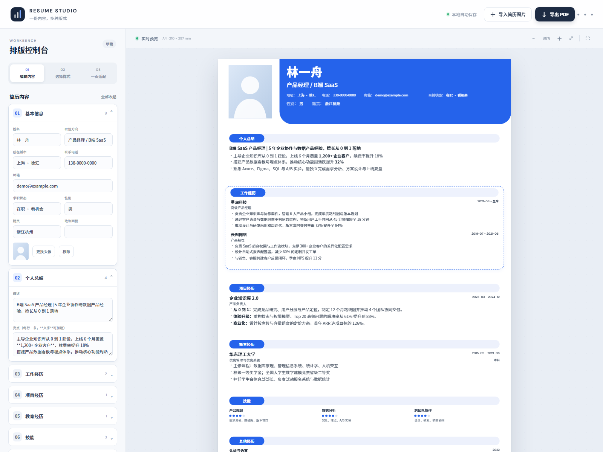

# Image Resume Studio · 简历排版工作台

> 从一张简历截图出发，复刻它原本的版式，得到一份可编辑、可导出、严格一页 A4 的简历。

[](LICENSE)
[](#技术实现)
[](#隐私与数据)

在线试用：<https://7aaaaah.github.io/image-resume-studio/>  
示例成品：[demo-resume.pdf](screenshots/demo-resume.pdf)



## 这是什么

不是又一个"填表套模板"的简历工具，而是把**已有的简历图片**当作设计稿：

1. 上传简历截图；
2. 提取主色、头部结构、圆角与信息密度；
3. OCR 识别文字并进入校对；
4. 生成可编辑的一页 A4 简历；
5. 继续微调样式、内容与版面，导出 PDF / HTML / JSON。

整个工作台是几个静态文件，双击 `index.html` 就能用，不需要 Node.js、Python、数据库或服务器。

## 功能

- **图片转模板**：从截图检测主色、头部高度、右下圆角与侧栏，自动匹配四种基础版式并给出置信度
- **模板 DSL**：样式与内容分离，可导出 / 导入 `.resume-template.json`，方便复用与分享
- **内容可编辑**：基本资料、个人总结、工作经历、项目经历、教育、技能、自定义经历
- **四种版式**：蓝白经典 / 左侧信息栏 / 编辑感留白 / 极简线条
- **细节可调**：主色、内容密度、页边距、头部轮廓、头像显隐
- **一页适配**：实时显示版面占用率，一键智能压缩到单页 A4
- **三种导出**：PDF（浏览器打印）、独立 HTML、JSON
- **本地优先**：内容保存在浏览器 localStorage，不上传服务器
- **OCR 校对**：识别后先校对姓名、电话、日期与数字，再生成内容

## 快速开始

### 直接使用（推荐给非开发者）

1. 下载本仓库 ZIP 并完整解压；
2. 双击 `index.html`，用 Edge 或 Chrome 打开；
3. 左侧编辑，右侧实时预览。

> 不要把 `index.html` 单独拷出来，它还需要同目录的 `styles.css`、`app.js` 与头像文件。

### 本地开发

无需构建、无需安装依赖：

```bash
git clone https://github.com/7AAAAAH/image-resume-studio.git
cd image-resume-studio
```

直接打开 `index.html`，或使用任意静态服务器：

```bash
python -m http.server 8080
```

### 修改源码

`app.js` 是构建产物。请编辑 `src/*.js`，然后运行：

```bash
npm run build
npm test
```

构建脚本只是按固定顺序拼接源码片段，不引入任何运行时依赖，因此发布版仍然可以直接双击打开。Node.js 22+ 仅用于构建和测试。

### 导出 PDF

在浏览器打印窗口中选择：

- 纸张：A4
- 边距：无
- 缩放：默认
- 勾选"背景图形 / 打印背景"

## 与同类项目的差异

主流开源简历工具（Reactive Resume、Magic Resume、JadeAI 等）大多采用"内容到内置模板"的路径；本项目的方向相反：**先理解原简历的视觉设计，再产出可编辑模板**。

详细的竞品调研、差距与优化方向见 [docs/competitive-analysis.md](docs/competitive-analysis.md)。

模板格式见 [schema/resume-template.schema.json](schema/resume-template.schema.json)，示例见 [examples/demo-template.json](examples/demo-template.json)。

## 路线图

| 版本 | 主题 | 关键能力 |
| --- | --- | --- |
| v0.1 | 当前版本 | 图片取色 + OCR + 四版式 + 一页适配 + 三种导出 |
| v0.2 | 可维护 | 模块拆分、自动化测试、离线 OCR、CI 与 Pages |
| v0.3 | 真正理解版式 | 视觉大模型版式解析、版面 DSL、模板编辑器 |
| v0.4 | 从排版到求职 | JD 匹配、ATS 检查、内容建议、DOCX |
| v1.0 | 可分发 | 模板市场、多简历管理、分享链接 |

完整计划（含验收标准、风险与指标）见 [docs/roadmap.md](docs/roadmap.md)。

## 技术实现

- 原生 HTML / CSS / JavaScript，无框架、无运行时依赖
- `src/` 按模块拆分，`scripts/build.js` 拼接为单文件 `app.js`
- CSS 变量驱动主题，A4 固定画布 794 × 1123 px
- Canvas 采样提取图片主色，规则匹配版式特征
- Tesseract.js 在浏览器内 OCR（首次使用需联网加载引擎与语言包）
- localStorage 持久化，JSON 导入导出用于跨设备迁移
- 单元测试与无依赖的 CDP 端到端冒烟测试

架构说明见 [docs/architecture.md](docs/architecture.md)。

## 隐私与数据

- 简历内容只保存在当前浏览器的 localStorage；
- 图片不会上传到任何服务器；
- OCR 引擎与语言包由 CDN 加载，首次使用需要联网；
- 仓库内的示例简历为虚构数据（林一舟 / demo@example.com）。

## English

Image Resume Studio turns a screenshot of an existing resume into an editable, print-ready A4 resume. It extracts the palette and layout cues, runs in-browser OCR, and keeps everything local. No build step, no server, no account. See [docs/roadmap.md](docs/roadmap.md) for the roadmap.

## 贡献

欢迎提交 Issue 与 PR。请先阅读 [CONTRIBUTING.md](CONTRIBUTING.md)。

## 许可

[MIT](LICENSE)

## 免责声明

本项目与任何招聘平台无关；示例内容仅用于演示。请勿把真实敏感信息放入公共仓库或公共演示环境。
